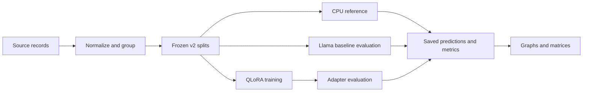
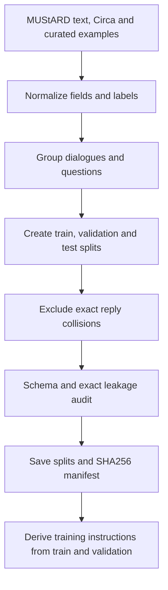
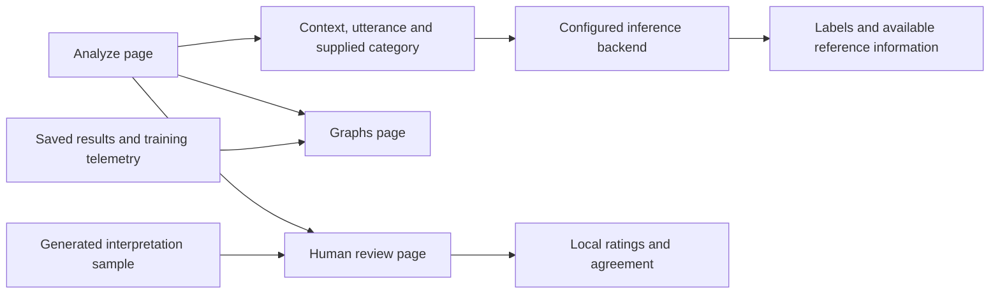
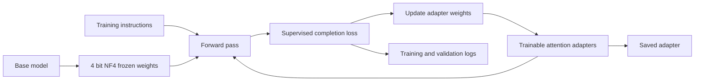
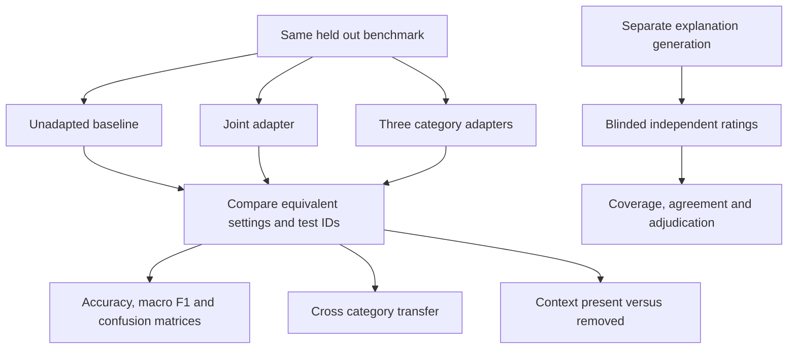

# Architecture

The implemented software separates benchmark construction, measured CPU inference, GPU experiment execution and human scoring. The diagrams describe supported workflows, not proof that all experiments have run.

## Overall workflow

## Preprocessing

Near duplicates and pretraining contamination are not eliminated by exact-match checks.

## Application

## QLoRA

The joint configuration uses rank 16, alpha 32, dropout 0.05, learning rate 0.00015, three epochs, sequence length 512 and effective batch size eight on one device. These are configured settings, not completed-run observations.

## Experiments

